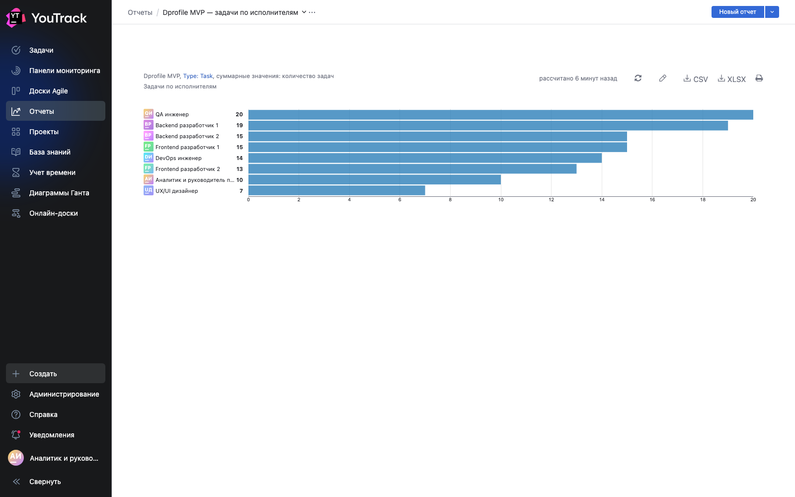
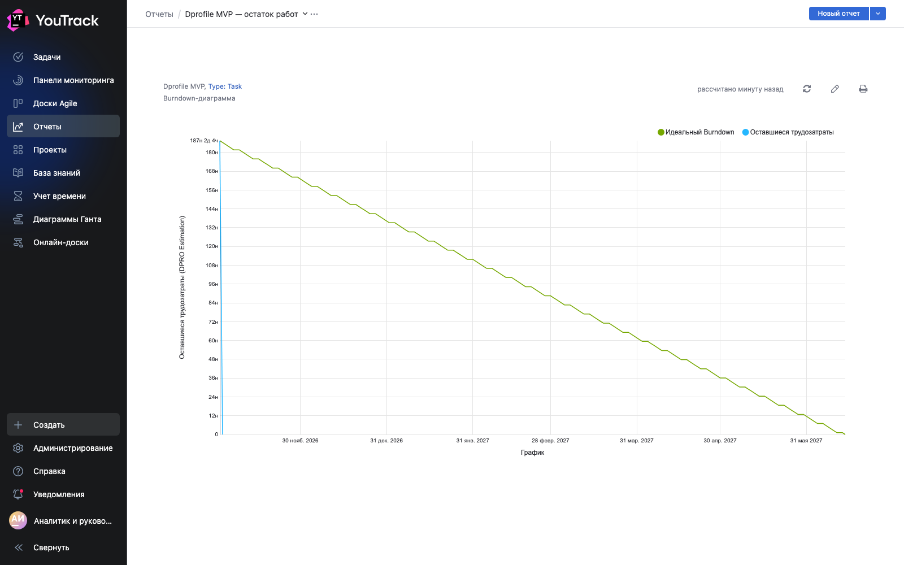
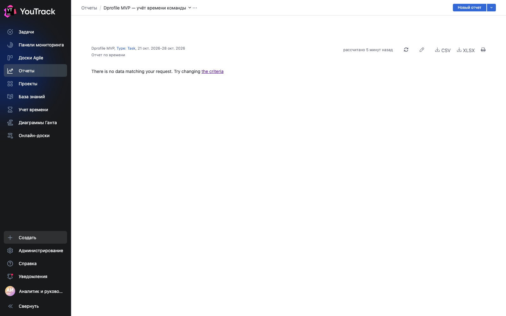
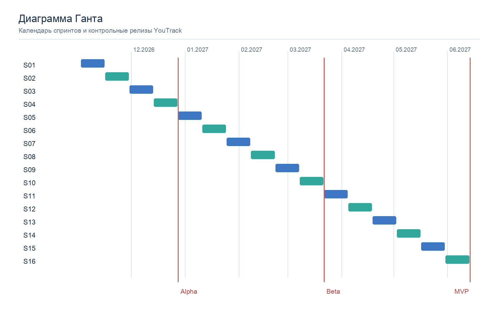

# ОТЧЁТ ПО ЛАБОРАТОРНОЙ РАБОТЕ № 2

**Дисциплина:** Экономика программной инженерии  
**Тема:** Планирование Scrum-проекта в YouTrack  
**Проект:** Dprofile MVP — платформа для дизайнеров и заказчиков  
**Выполнили:** Малышев Михаил Александрович, Дорохин Сергей Константинович, P3411  
**Дата среза:** 29 октября 2026 г.

## 1. Цель и исходные данные

Цель работы — сформировать команду, спланировать загрузку и организовать разработку MVP Dprofile в YouTrack по Scrum. Функциональные требования и оценка взяты из [лабораторной работы № 1](../lab1/report.md). В состав MVP входят авторизация, профили, портфолио, фрагменты, каталоги, вакансии и заказы, образование, социальные функции, PRO-статусы и модерация.

Итоговая плановая трудоёмкость — **7 500 чел.-ч** (46,9 чел.-мес. при 160 ч/мес.), включая резерв 20 %. Продолжительность плана — **16 двухнедельных спринтов**, с 2 ноября 2026 г. по 14 июня 2027 г. Выбранный в варианте профиль проекта — **Scrum**.

## 2. Проектная команда и учётные записи

В YouTrack создан проект [Dprofile MVP](https://skdorokhinmamalyshev.youtrack.cloud/projects/DPRO) (`DPRO`). В проектную команду добавлены восемь учётных записей разных специализаций. Созданные адреса используют домен `example.invalid`; перед началом совместной работы их нужно заменить действительными почтовыми адресами участников. Пароли хранятся вне репозитория в локальном файле `~/.codex/dprofile-team-credentials.json` с правами `0600`.

| Специализация | Учётные записи | Состав | План, ч | Фонд за 8 месяцев, ч | Загрузка |
|---|---|---:|---:|---:|---:|
| Аналитика и управление | `dpro.pm` | 1 | 850 | 1 280 | 66 % |
| UX/UI | `dpro.ux` | 1 | 650 | 1 280 | 51 % |
| Frontend | `dpro.fe1`, `dpro.fe2` | 2 | 2 110 | 2 560 | 82 % |
| Backend | `dpro.be1`, `dpro.be2` | 2 | 2 240 | 2 560 | 88 % |
| QA | `dpro.qa` | 1 | 1 000 | 1 280 | 78 % |
| DevOps | `dpro.devops` | 1 | 650 | 1 280 | 51 % |
| **Итого** | **8 участников** | **8** | **7 500** | **10 240** | **73 %** |

Фонд рассчитан как 8 месяцев × 160 ч × число специалистов. Ответственный в карточке YouTrack отвечает за её результат; оценка ресурса по роли учитывает участие других членов команды.

## 3. Ресурсный план по этапам

| Роль, чел.-ч | Исследование S01–S02 | Основа S03–S04 | Ядро S05–S10 | Расширение S11–S12 | Проверка и релиз S13–S16 | Всего |
|---|---:|---:|---:|---:|---:|---:|
| Аналитика и управление | 150 | 130 | 300 | 100 | 170 | 850 |
| UX/UI | 150 | 150 | 250 | 70 | 30 | 650 |
| Frontend | 120 | 260 | 900 | 300 | 530 | 2 110 |
| Backend | 160 | 290 | 960 | 300 | 530 | 2 240 |
| QA | 40 | 100 | 390 | 150 | 320 | 1 000 |
| DevOps | 100 | 150 | 160 | 80 | 160 | 650 |
| **Всего** | **720** | **1 080** | **2 960** | **1 000** | **1 740** | **7 500** |

Этап «Ядро» загружает двух backend-разработчиков на 960 ч за три месяца — практически полный фонд. На обзоре спринта S04 необходимо уточнить оценки и при необходимости перенести часть функций поиска и модерации.

## 4. Настройка проекта

Проект создан по Scrum-шаблону. Доска **«Разработка проекта Dprofile MVP»** (`204-1`) содержит четыре столбца, связанные с состоянием задачи:

| Столбец | Поле `State` | Условие перевода |
|---|---|---|
| Открыта | Open | Задача сформулирована и готова к работе |
| В обработке | In Progress | Работа началась |
| Подлежит проверке | To Verify | Результат передан на ревью или тестирование |
| Готово | Done | Критерии приёмки выполнены |

В проекте включён учёт времени. Поле `DPRO Estimation` хранит оценку в часах, `DPRO Spent time` — учтённое время. У задач указаны `Assignee`, `Sprints`, `Fix versions` и `Type`. Созданы **16 спринтов** с целями и датами.

Релизный план отражён тремя версиями в поле `Fix versions`. На дату отчёта они являются **плановыми**:

| Версия | Плановая дата | Объём |
|---|---|---|
| 0.1 Alpha | 28.12.2026 | Дизайн-система, роли, авторизация, профили |
| 0.5 Beta | 22.03.2027 | Публикации, поиск, вакансии, образование |
| 1.0 MVP | 14.06.2027 | Платежи, уведомления, тестирование и приёмка |

### Репозиторий и электронная почта

Git-репозиторий проекта — [serezk4-itmo/epi2](https://github.com/serezk4-itmo/epi2). Он подключён к YouTrack. В имени рабочей ветви и сообщении коммита используется ключ `DPRO-N`, чтобы изменения связывались с задачей. Основная ветвь — `main`; для активной работы используются `feature/DPRO-N-тема`, для подготовки выпуска — `release/версия`. Состояние ветвей и проверка связи коммита с задачей приведены в разделе 7.

Для почтовых уведомлений нужна действующая SMTP-конфигурация и реальные адреса получателей. Эти параметры пока не предоставлены. Работа оформлена отдельной задачей [DPRO-18](https://skdorokhinmamalyshev.youtrack.cloud/issue/DPRO-18); до успешной отправки тестового письма интеграцию с электронной почтой нельзя считать завершённой.

## 5. План работ и workflow

Backlog состоит из **16 эпиков** и **111 детальных задач**, сгруппированных по 6–8 задач в каждом спринте. Детальные карточки описывают конкретный результат и критерии приёмки; в описании карточки нет пересказа цели спринта. Каждая детальная задача привязана к родительскому эпику, спринту, релизной версии и ответственному. Сумма оценок **только детальных задач** составляет **7 500 ч**. YouTrack автоматически агрегирует оценки подзадач в эпиках, поэтому при расчёте метрик нельзя складывать оценки эпиков с их дочерними задачами.

| Этап | Спринты и даты | Основной результат | Число детальных задач |
|---|---|---|---:|
| Исследование | S01–S02, 02.11–30.11.2026 | Требования, архитектура, дизайн-система | 12 |
| Основа | S03–S04, 30.11–28.12.2026 | Окружения, авторизация, профили | 14 |
| Ядро | S05–S10, 28.12.2026–22.03.2027 | Портфолио, социальные функции, поиск, модерация, вакансии, образование | 42 |
| Расширение | S11–S12, 22.03–19.04.2027 | PRO, платежи, уведомления и рекомендации | 15 |
| Проверка и релиз | S13–S16, 19.04–14.06.2027 | Тестирование, исправления, документация, приёмка | 28 |
| **Итого** | **16 спринтов** |  | **111** |

Примеры детальной декомпозиции: [сценарии регистрации](https://skdorokhinmamalyshev.youtrack.cloud/issues?q=project%3A%20DPRO%20%22%D1%80%D0%B5%D0%B3%D0%B8%D1%81%D1%82%D1%80%D0%B0%D1%86%D0%B8%D0%B8%22), авторизация, публичный профиль, загрузка медиа, поисковый индекс, отклики, платёжный контур, регресс и выпуск. В одном спринте работают аналитик, дизайнер, frontend, backend, QA и DevOps в зависимости от состава задач.

Принятый workflow: **Open → In Progress → To Verify → Done**. Если результат не проходит проверку, задача возвращается в In Progress, а обнаруженный самостоятельный дефект регистрируется как Bug. На планировании команда выбирает задачи из backlog; в ходе спринта обновляет состояние и учёт времени; на обзоре принимает результат и уточняет следующий спринт.

Уже закрыта задача [DPRO-17](https://skdorokhinmamalyshev.youtrack.cloud/issue/DPRO-17) по проверке настройки доски: она прошла состояния In Progress и To Verify перед Done. После обнаружения потребности в SMTP-параметрах открыта DPRO-18. Это фиксирует последовательность «выполненная работа → новая зависимость» без заявления о готовности функциональности MVP.

## 6. Отчёты YouTrack и интерпретация

В разделе [Reports](https://skdorokhinmamalyshev.youtrack.cloud/reports) созданы встроенные отчёты:

| Отчёт | ID | Настройка |
|---|---|---|
| Отчёт по времени | `227-2` | Проект DPRO, только Type: Task |
| Burndown | `565-0` | Проект DPRO, только Type: Task, оценка `DPRO Estimation` |
| Диаграмма Ганта | `430-2` | Проект DPRO, только Type: Task, оценка `DPRO Estimation` |

Отчёт **по исполнителям** приведён ниже как срез задач из YouTrack. Он отражает количество назначенных карточек, а не индивидуальную трудоёмкость: несколько участников могут работать над одной задачей. Эпики исключены, чтобы не считать одну и ту же работу дважды.

| Исполнитель | Задач |
|---|---:|
| `dpro.qa` | 20 |
| `dpro.be1` | 19 |
| `dpro.be2` | 15 |
| `dpro.fe1` | 15 |
| `dpro.devops` | 14 |
| `dpro.fe2` | 13 |
| `dpro.pm` | 10 |
| `dpro.ux` | 7 |
| **Всего** | **113** |

В срез включены 111 продуктовых задач и две задачи по настройке проекта. Диаграмма построена по данным карточек YouTrack; остальные три отчёта сохранены во встроенном разделе Reports.

В burndown плановая линия снижается от 7 500 ч к нулю к завершению S16. Фактическая линия на дату среза остаётся на начальном уровне: продуктовые задачи не закрывались. Это нормальное состояние до старта первого спринта; график не следует выдавать за результат завершённого проекта.

В учёте времени сейчас **0 ч по разработке MVP**. Время добавляется по work items после выполнения задач; отсутствие записей не означает нулевую плановую стоимость. Сравнение плана с фактом станет возможным после начала разработки.

Плановая диаграмма Ганта строится по календарю спринтов и датам релизов. Встроенный отчёт YouTrack создан с полем оценки `DPRO Estimation`. Для достоверного критического пути потребуется указать зависимости между детальными задачами и уточнить оценки после первых спринтов.

## 7. Проверка конфигурации и дальнейшая работа

Проверены создание проекта, доски, 16 спринтов, 3 релизных версий, состав команды, связи задач с эпиками и привязка к спринтам. В GitHub опубликованы ветви `main`, `develop`, `feature/DPRO-21-domain-model`, `feature/DPRO-22-api-design`, `feature/DPRO-24-infrastructure`, `feature/DPRO-28-design-system` и `feature/DPRO-29-responsive-layout`. Остальные рабочие ветви создаются при взятии задач в спринт; релизные ветви — при подготовке соответствующей версии.

Связь GitHub с YouTrack подтверждена: коммит [`a229d7d`](https://github.com/serezk4-itmo/epi2/commit/a229d7da43940dfbde6482af8594290439b5a31c) с ключом `DPRO-17` появился в разделе VCS карточки DPRO-17. Статистика на дату среза характеризует **начало проекта**, а не его завершение; итоговые отчёты нужно переснять после S16.

Следующие работы: настроить SMTP и действительные адреса, реализовать задачи ближайших спринтов в ветках `feature/DPRO-N-*`, отмечать время и переходы состояний, затем выпустить версии Alpha, Beta и MVP.

## Источники

1. [Лабораторная работа № 1](../lab1/report.md) — требования и оценка трудоёмкости.
2. [YouTrack: настройка проекта](https://www.jetbrains.com/help/youtrack/cloud/configuring-a-project.html).
3. [YouTrack: типы отчётов](https://www.jetbrains.com/help/youtrack/cloud/youtrack-reports.html).
4. [YouTrack: burndown](https://www.jetbrains.com/help/youtrack/cloud/burndown.html).
5. [YouTrack: отчёт по времени](https://www.jetbrains.com/help/youtrack/cloud/time-report.html).
